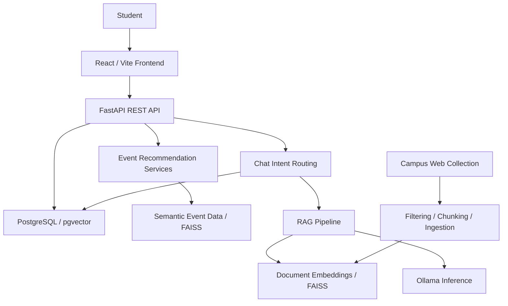

# Smart Campus Assistant Platform

## Overview

The Smart Campus Assistant Platform is a web-based application designed to make university information easier for students to access. Campus information is often distributed across different systems, making it difficult to quickly find information about courses, professors, dining, academic deadlines, and campus events.

The platform brings this information together through a centralized student dashboard, a ML recommendation engine, and a LLM chatbot. Students can explore campus resources, manage their interests, and receive personalized event recommendations.

## Prototype 2 Features

- Student dashboard with campus information and event recommendations
- Login and signup interfaces
- Student profiles and interest management
- Campus events, dining, courses, professor information, and academic deadlines
- Professor review interfaces with ratings and voting
- Interest-based event recommendations using category matching and semantic similarity
- Natural-language chatbot with structured database responses and retrieval-augmented generation (RAG)
- Campus knowledge collection, document processing, and semantic search
- PostgreSQL database integration with pgvector support
- REST API with interactive documentation
- Containerized development environment and automated testing

The alpha interface uses demonstration authentication and browser-local reviews. Use synthetic accounts and data for development and demonstrations.

## Technology Stack

### Backend

- Python 3.12
- FastAPI and Uvicorn
- Psycopg 3
- Pydantic

### Frontend

- React 19
- Vite 8
- JavaScript, HTML, and CSS modules
- Node.js 22 for the containerized frontend

### Database

- PostgreSQL 16
- pgvector
- Supabase project dashboard

### AI and Recommendations

- Sentence Transformers: `sentence-transformers/all-MiniLM-L6-v2`
- FAISS for semantic retrieval
- Ollama for local language-model inference
- `qwen3-direct`, based on `qwen3:4b`
- Category-based and semantic event recommendation services

### Development and Quality Tools

- Docker and Docker Compose
- Pytest and pytest-cov
- Ruff and ESLint
- GitHub Actions
- Gitleaks
- Mypy, Bandit, Complexipy, and pip-audit for additional analysis

## System Architecture



The frontend communicates with the backend through `frontend/src/api.js`. The backend retrieves campus information, stores student interests, and generates recommendations. Chat requests use structured campus data first and use the RAG pipeline for additional campus knowledge when enabled.

The RAG pipeline retrieves relevant document chunks and sends them to Ollama to generate source-grounded responses. Document search uses FAISS artifacts; PostgreSQL stores the platform's relational data and defines vector-enabled knowledge tables.

Additional documentation:

- [Architecture Overview](https://github.com/calculusrabbit/smart_campus_assistant/wiki/Architecture-Overview)
- [Database Schema](https://github.com/calculusrabbit/smart_campus_assistant/wiki/Database-Schema)
- [Core Conventions](https://github.com/calculusrabbit/smart_campus_assistant/wiki/Core-Conventions)
- [Developer Onboarding](docs/DEVELOPER_ONBOARDING.md)

## Repository Structure

```text
frontend/                       React student interface
main.py                         FastAPI routes and chat request handling
models.py                       API request models
database.py                     Database access and response formatting
services/
  event_recommender.py           Semantic event recommendations
  recommendation_service.py     Interest and category matching
  recommender_config.py         Recommendation settings
  rag/                          Retrieval, generation, and knowledge processing
    data/                       Document data and FAISS artifacts
    processing/                 Filtering, chunking, and ingestion
    scrapers/                   Campus information collection
    tests/                      RAG and scraper tests
static/                         Backend-served web interface
tests/                          API and database tests
docs/                           Developer documentation
migrations/                     Prototype 1 migration and rollback scripts
sca_database_v0.4.0.sql          Expanded database schema
sca_database_v0.4.0_DOWN.sql     Expanded schema teardown
seed.py                         Development/test seeding entry point
dummy_data_populator_v0.5.0.py   Synthetic data generator
.github/workflows/              Automated CI and PR validation
AI_USAGE_LOG.md                 AI usage and verification records
```

The frontend uses React state for page navigation. Backend responsibilities are separated into API routing, data access, request validation, recommendation services, and RAG processing. The recommendation services encapsulate matching and ranking logic separately from the UI and API routes.

## Database

The database supports the following domains:

| Domain | Tables |
| --- | --- |
| Institutions and locations | `schools`, `departments`, `locations` |
| Accounts and students | `users`, `students`, `authentications` |
| Academics | `courses`, `sessions`, `instructors`, `offerings`, `enrolments`, `registrations`, `attendance`, `deadlines` |
| Events | `events`, `event_responses`, `event_embeddings` |
| Dining | `dining`, `dining_items` |
| Reviews | `reviews_generic`, `review_replies`, `review_votes`, `reviews_educational`, `reviews_dining`, `reviews_resources` |
| Communities | `groups`, `memberships`, `notifications` |
| Campus knowledge | `scraped_information` |

The schema defines relational constraints, validation checks, indexes, trigger functions, and 384-dimensional vector columns. Student interests are stored in `students.interests`; professor-facing API responses are assembled from instructor data.

### Supabase Project

[Open the Smart Campus Assistant Supabase dashboard](https://supabase.com/dashboard/project/qlivdhjehiohlptbzlpn/)

Access requires an authorized Supabase account. Local Docker development uses its own PostgreSQL instance; the dashboard link is not a database connection string.

## Environment Variables

Copy the sanitized configuration template before starting the application:

```bash
cp .env.example .env
```

Set a local database password and configure the following values as needed:

| Variable | Purpose | Default / example |
| --- | --- | --- |
| `POSTGRES_DB` | Database name | `smart_campus` |
| `POSTGRES_USER` | Database username | `smartcampus` |
| `POSTGRES_PASSWORD` | Database password | Set locally |
| `POSTGRES_HOST` | Database hostname inside Compose | `db` |
| `POSTGRES_PORT` | Internal database port | `5432` |
| `API_HOST_PORT` | Backend host port | `8000` |
| `FRONTEND_HOST_PORT` | Frontend host port | `5173` |
| `RAG_ENABLED` | Enable the RAG chat fallback | `true` |
| `HF_TOKEN` | Optional Hugging Face access token | Leave empty unless needed |

Compose also accepts `DB_MEMORY_LIMIT`, `BACKEND_MEMORY_LIMIT`, and `FRONTEND_MEMORY_LIMIT` for container resource limits. The `APP_ENV` setting authorizes synthetic database seeding when explicitly set to `development` or `test`.

Use the default application ports with the current API client and CORS configuration. The database is accessible to Compose services without publishing a host port. Model names, Ollama connectivity, retrieval paths, and chunk settings are configured in `services/rag/config.py`.

Do not commit `.env`, access tokens, database credentials, or real student information.

## Running with Docker

### Prerequisites

- Git
- Docker and Docker Compose v2
- Ollama for local AI-generated responses
- Node.js 22 and npm if generating the frontend dependency lockfile locally

### Start the Application

```bash
git clone https://github.com/calculusrabbit/smart_campus_assistant.git
cd smart_campus_assistant
cp .env.example .env
```

Edit `.env` and set `POSTGRES_PASSWORD`. For a database-backed demonstration without AI generation, set `RAG_ENABLED=false`.

Generate the lockfile with `npm install` from `frontend/` when needed.

Build and start the development stack:

```bash
docker compose up --build
```

| Component | URL |
| --- | --- |
| Student interface | http://localhost:5173 |
| Backend web interface | http://localhost:8000 |
| Interactive API documentation | http://localhost:8000/docs |
| OpenAPI specification | http://localhost:8000/openapi.json |

Inspect services and logs:

```bash
docker compose ps
docker compose logs --tail=100 backend frontend db
```

Stop the application:

```bash
docker compose down
```

Named volumes preserve local data between runs. Use volume deletion only for an intentional disposable-environment reset.

## Database Setup and Schema Changes

The expanded schema is defined in `sca_database_v0.4.0.sql`. PostgreSQL runs the configured initialization SQL when creating a new database volume.

To initialize an explicitly empty database manually:

```bash
docker compose exec -T db sh -c \
  'psql -v ON_ERROR_STOP=1 -U "$POSTGRES_USER" -d "$POSTGRES_DB"' \
  < sca_database_v0.4.0.sql
```

For schema work:

- Pair changes with executable rollback scripts and verify both directions on a disposable database.
- Record migration and rollback results in the associated GitHub Issue.
- Back up existing data before applying changes.
- Use `sca_database_v0.4.0_DOWN.sql` only for an intentional expanded-schema teardown.


## Seed Data

Populate a disposable local database with synthetic data:

```bash
docker compose exec -e APP_ENV=development backend python seed.py --reset
```

This resets application data and invokes `dummy_data_populator_v0.5.0.py`. Use only a verified development/test database. Synthetic data supports repeatable testing and demonstrations without exposing real student records.

## AI and Campus Knowledge

### Ollama Setup

With Ollama running on the host, execute from the repository root:

```bash
ollama pull qwen3:4b
ollama create qwen3-direct -f Modelfile.qwen3-direct
ollama list
```

The backend configuration uses `http://host.docker.internal:11434` for Ollama. Ensure the backend container can reach that address; Linux environments may require a host-gateway mapping and suitable host listener configuration.

Set `RAG_ENABLED=true` in `.env` and recreate the backend after changing its environment:

```bash
docker compose up -d --force-recreate backend
```

### Knowledge Processing

Campus knowledge preparation follows this sequence:

```text
Campus source collection
        -> Content filtering
        -> Page chunking
        -> Document normalization and ingestion
        -> Embedding generation
        -> FAISS index creation
```

Document retrieval uses the matching `chunks.json` and `document_index.faiss` files in `services/rag/data/`. To rebuild the document index from prepared chunks:

```bash
python -m services.rag.embed_and_load
```

Run this command in a Python environment with the project dependencies installed. Keep chunk records and index vectors aligned, and restart the backend after replacing retrieval artifacts.

Semantic event recommendations use a separate `all_events.json` and `events_index.faiss` pair. Recommendation thresholds and date windows are defined in `services/recommender_config.py`; category matching provides the alternate recommendation path.

## API Endpoints

| Method | Endpoint | Purpose |
| --- | --- | --- |
| GET | `/events` | Campus events |
| GET | `/dining` | Dining information |
| GET | `/courses` | Courses; optional `code` and `professor` filters |
| GET | `/professors` | Professor information |
| GET | `/deadlines` | Academic deadlines |
| POST | `/recommendations/events` | Recommendations from supplied interests |
| GET | `/students/{student_id}/interests` | Read saved interests |
| POST | `/students/{student_id}/interests` | Save student interests |
| GET | `/students/{student_id}/recommendations/events` | Recommendations from a saved student profile |
| POST | `/chat` | Natural-language campus questions |

Example requests:

```bash
curl --fail http://localhost:8000/events

curl --fail http://localhost:8000/recommendations/events \
  -H 'Content-Type: application/json' \
  -d '{"interests":["coding","career"]}'

curl --fail http://localhost:8000/chat \
  -H 'Content-Type: application/json' \
  -d '{"message":"What events are happening on campus?"}'
```

Chat responses include an intent and reply, with structured data or retrieved sources as appropriate. Interactive request and response schemas are available at `/docs`.

## Code Quality

Install Python development dependencies in a virtual environment:

```bash
python3.12 -m venv .venv
source .venv/bin/activate
python -m pip install -r requirements.txt -r requirements-dev.txt
```

Run Python linting and configured type analysis:

```bash
ruff check .
mypy
```

Ruff configuration includes a cyclomatic complexity limit of 10. Keep methods focused, encapsulate business logic in services, and document public interfaces and non-obvious behavior.

Run frontend validation:

```bash
cd frontend
npm ci
npm run lint
npm run build
```

## Testing

Tests cover campus API responses, database access, interest management, recommendation behavior, retrieval, and generation handling. Run against a seeded, disposable test database with the appropriate `POSTGRES_*` environment variables.

```bash
python -m pytest tests -q
python -m pytest services/rag/tests -q
```

Run the combined suite with coverage and exported reports:

```bash
python -m pytest -q \
  --cov=main --cov=database --cov=services \
  --cov-report=term-missing \
  --cov-report=xml:coverage.xml \
  --cov-report=html:htmlcov \
  --cov-fail-under=60 \
  --junitxml=test-results.xml
```


## Security and Data Privacy

Prototype 2 security review covers secure authentication and session handling, password hashing, secret management, OWASP Top 10 risks, dependency vulnerabilities, PII protection, and soft-delete behavior. 

The schema includes hashed-password storage and `deleted_timestamp` fields for applicable account/review records. Security review should verify their behavior through the application workflows. Use sanitized configuration, synthetic test data, and restricted project/database access.

Useful audit commands include:

```bash
pip-audit
bandit -r main.py models.py database.py services

# from frontend/:
npm audit
```

## Continuous Integration

GitHub Actions provide:

1. Secret scanning with Gitleaks
2. Python 3.12 environment and dependency setup
3. Ruff static analysis
4. PostgreSQL/pgvector service setup
5. Expanded schema initialization and synthetic seeding
6. Automated tests with a 60% coverage threshold
7. Uploaded test and coverage reports
8. Separate RAG tests for applicable changes
9. Conventional PR-title validation

CI logs and reports should be linked from the associated issues and prototype submission. Run the frontend lint/build and applicable security checks as part of release validation, and enforce required checks through repository branch protection.

## Development Workflow

- Use GitHub Issues for implementation tasks, bugs, test results, security findings, and refactoring work.
- Create `feature/*` or `chore/*` branches for development.
- Use [Conventional Commits 1.0.0](https://www.conventionalcommits.org/en/v1.0.0/) and provide a scope where helpful.
- Link feature and bug-fix PRs to their issues, for example `Closes #42`.
- Require at least one other team member's approval before merging into `main`.
- Follow [Semantic Versioning 2.0.0](https://semver.org/) and maintain an automated changelog or semantic-release history.
- Update setup instructions, architecture diagrams, schema documentation, and tests alongside implementation changes.

Example commit messages:

```text
feat(recommendations): add semantic event matching
fix(api): validate student interests
test(database): cover profile updates
ci(security): add dependency auditing
docs(readme): update alpha setup instructions
```

## Prototype Milestones and Submission Package

The cumulative submission package through Prototype 2 includes:

- Peer-reviewed MVP changes merged into `main`, a tagged release, and release history
- Reproducible local setup, sanitized environment examples, synthetic seed data, and verified schema rollback evidence
- Updated README, visual architecture documentation, schema reference, and developer onboarding guide
- Integration test reports with at least 60% coverage and issue-linked results
- Static-analysis metrics, dependency audit results, OWASP review, and remediation evidence
- Verified authentication, privacy, and soft-delete workflows
- Environment feature-toggle documentation, including `RAG_ENABLED`
- A cumulative, Team Lead-reviewed [AI Usage Log](AI_USAGE_LOG.md) recording prompts, generated output, human changes, and validation, including Sprint 2–3 records
- Repository/release link and CI run URL for submission

## Team
### The Three Musketeers
#### Arpan Dey, Vu Nguyen, Teng Fai Leong
Wichita State University Senior Design Project
